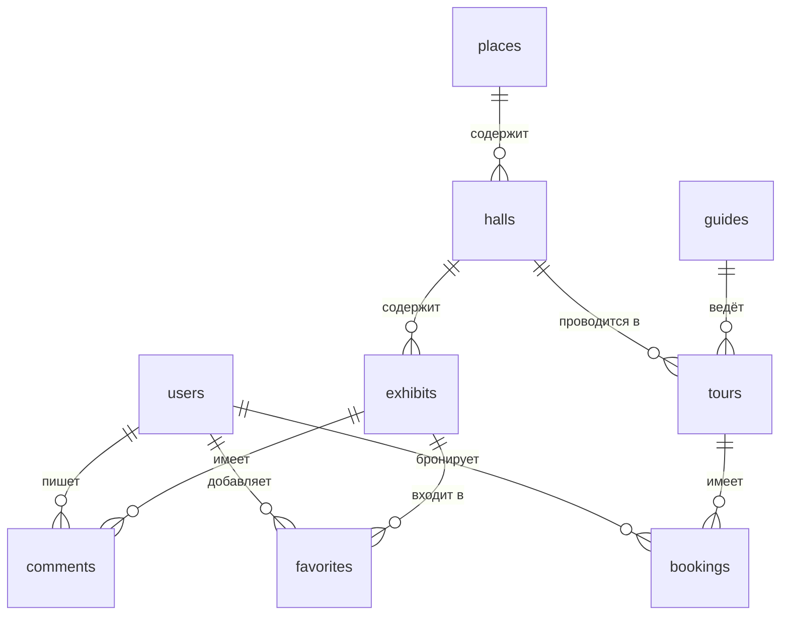

# Раздел 1. Анализ предметной области

## 1.1 Описание

Приложение «Музей» предназначено для автоматизации работы с посетителями музея с мобильных устройств под управлением ОС Android. У музея несколько площадок (зданий), в каждой свои залы и экспонаты. Посетитель может смотреть коллекцию по залам с фотографиями, искать экспонаты, оставлять отзывы с оценкой, добавлять экспонаты в избранное, узнавать об экскурсоводах и площадках и записываться на экскурсии на конкретный сеанс с учётом свободных мест.

Данные общие для всех устройств. Приложение работает с локальной базой SQLite, а изменения синхронизируются через облачную базу Firebase Firestore. Поэтому запись, сделанная на одном телефоне, видна на всех остальных. Без интернета приложение продолжает работать с локальной копией.

## 1.2 Роли пользователей

| Роль | Что может делать |
|---|---|
| **Клиент (посетитель)** | Регистрация и вход; просмотр экспонатов по залам с фото; поиск; карточка экспоната; отзывы и оценки; избранное; экскурсии, экскурсоводы и площадки; запись на сеанс экскурсии; просмотр и отмена своих записей; профиль (имя, пароль); тёмная тема |
| **Администратор** | Всё то же, что клиент, плюс панель администратора: экспонаты (с фото из галереи), залы, экскурсоводы, площадки (добавление, изменение, удаление); все брони и смена их статуса; удаление любых отзывов |

Администратор по умолчанию: логин `admin`, пароль `admin123`.

## 1.3 Основные сущности

- **Пользователь** - тот, кто пользуется приложением.
- **Площадка** - здание музея: адрес, метро, часы работы, телефон, координаты, фото.
- **Зал** - часть площадки, к нему относятся экспонаты и экскурсии.
- **Экспонат** - предмет коллекции: фото, автор, датировка, материал, инвентарный номер.
- **Отзыв** - комментарий посетителя с оценкой от 1 до 5.
- **Избранное** - связь «пользователь - экспонат».
- **Экскурсовод** - сотрудник, который ведёт экскурсии: должность, стаж, языки, фото.
- **Экскурсия** - услуга с форматом (экскурсия, спектакль, квест), ценой, длительностью, сеансами и лимитом группы.
- **Бронь** - запись пользователя на сеанс экскурсии с датой, временем, количеством человек и статусом.

## 1.4 Схема базы данных

Локальная база: `museum.db` (SQLite, версия 2), 9 таблиц. Внешние ключи включены (`setForeignKeyConstraintsEnabled(true)`). При удалении родительской записи дочерние удаляются каскадно (`ON DELETE CASCADE`).

Id записей задаются приложением (время в миллисекундах + случайное число), а не AUTOINCREMENT, чтобы записи с разных телефонов не получили одинаковый id в общей базе.



### users - пользователи
| Поле | Тип | Описание |
|---|---|---|
| id | INTEGER PK | Идентификатор |
| login | TEXT NOT NULL UNIQUE | Логин |
| password | TEXT NOT NULL | Хеш пароля (SHA-256) |
| name | TEXT NOT NULL | Имя |
| role | TEXT NOT NULL | `user` или `admin` |

### places - площадки
| Поле | Тип | Описание |
|---|---|---|
| id | INTEGER PK | Идентификатор |
| name | TEXT NOT NULL | Название |
| address | TEXT NOT NULL | Адрес |
| metro | TEXT | Метро и время пешком |
| hours | TEXT | Часы работы |
| phone | TEXT | Телефон |
| description | TEXT | Описание |
| latitude, longitude | REAL | Координаты для кнопки «На карте» |
| image | TEXT | Фото (`res:имя` или base64) |

### halls - залы
| Поле | Тип | Описание |
|---|---|---|
| id | INTEGER PK | Идентификатор |
| place_id | INTEGER NOT NULL FK → places.id | Площадка |
| name | TEXT NOT NULL | Название зала |
| floor | INTEGER NOT NULL | Этаж |
| description | TEXT | Описание |

### exhibits - экспонаты
| Поле | Тип | Описание |
|---|---|---|
| id | INTEGER PK | Идентификатор |
| hall_id | INTEGER NOT NULL FK → halls.id | Зал |
| title | TEXT NOT NULL | Название |
| author | TEXT | Автор |
| year | TEXT | Год или век |
| description | TEXT | Описание |
| inv_number | TEXT | Инвентарный номер (ЭК-001...) |
| material | TEXT | Материал, техника |
| image | TEXT | Фото |

### comments - отзывы
| Поле | Тип | Описание |
|---|---|---|
| id | INTEGER PK | Идентификатор |
| exhibit_id | INTEGER NOT NULL FK → exhibits.id | Экспонат |
| user_id | INTEGER NOT NULL FK → users.id | Автор отзыва |
| text | TEXT NOT NULL | Текст |
| rating | INTEGER NOT NULL | Оценка 1-5 |
| date | TEXT NOT NULL | Дата и время |

### favorites - избранное
| Поле | Тип | Описание |
|---|---|---|
| user_id | INTEGER NOT NULL FK → users.id | Пользователь |
| exhibit_id | INTEGER NOT NULL FK → exhibits.id | Экспонат |

Первичный ключ составной: (user_id, exhibit_id), чтобы нельзя было добавить один экспонат дважды.

### guides - экскурсоводы
| Поле | Тип | Описание |
|---|---|---|
| id | INTEGER PK | Идентификатор |
| name | TEXT NOT NULL | Имя и фамилия |
| position | TEXT | Должность |
| experience | INTEGER NOT NULL | Стаж, лет |
| languages | TEXT | Языки экскурсий |
| bio | TEXT | О себе |
| image | TEXT | Фото |

### tours - экскурсии
| Поле | Тип | Описание |
|---|---|---|
| id | INTEGER PK | Идентификатор |
| hall_id | INTEGER NOT NULL FK → halls.id | Зал |
| guide_id | INTEGER NOT NULL FK → guides.id | Экскурсовод |
| title | TEXT NOT NULL | Название |
| description | TEXT | Описание |
| format | TEXT | Формат (экскурсия, спектакль, квест) |
| price | INTEGER NOT NULL | Цена взрослого билета, ₽ |
| duration | INTEGER NOT NULL | Длительность, мин |
| max_people | INTEGER NOT NULL | Максимум человек на сеанс |
| sessions | TEXT NOT NULL | Время сеансов через запятую |

### bookings - брони
| Поле | Тип | Описание |
|---|---|---|
| id | INTEGER PK | Идентификатор |
| user_id | INTEGER NOT NULL FK → users.id | Кто записался |
| tour_id | INTEGER NOT NULL FK → tours.id | Экскурсия |
| date | TEXT NOT NULL | Дата (дд.мм.гггг) |
| time | TEXT NOT NULL | Сеанс (чч:мм) |
| adults | INTEGER NOT NULL | Кол-во взрослых |
| children | INTEGER NOT NULL | Кол-во детей |
| audio_guide | INTEGER NOT NULL | Аудиогид (0/1) |
| total | INTEGER NOT NULL | Итоговая сумма, ₽ |
| status | TEXT NOT NULL | `new`, `confirmed`, `cancelled`, `done` |

## 1.5 Расчёт стоимости и свободных мест

```
итого = взрослые × цена + дети × (цена / 2) + (взрослые + дети) × 200 (если выбран аудиогид)
свободно мест = max_people − сумма (adults + children) по броням этого сеанса, кроме отменённых
```

Сумма пересчитывается сразу при любом изменении. Перед сохранением брони приложение скачивает свежие брони из облака и проверяет, что мест хватает.

## 1.6 Общая база (Firebase)

- В Firestore у каждой таблицы своя коллекция с таким же названием, одна строка - один документ.
- При добавлении, изменении или удалении запись сразу отправляется в облако.
- При запуске приложения, входе и по кнопке «Обновить данные» приложение скачивает все коллекции и перезаписывает локальную базу одной транзакцией.
- При самом первом запуске, когда облако пустое, туда загружаются стартовые данные: 3 площадки, 6 залов, 14 экспонатов, 5 экскурсоводов, 7 экскурсий.
- Фото, выбранные из галереи, сжимаются до 800 px (JPEG) и хранятся строкой base64, поэтому тоже видны на всех устройствах.

## 1.7 Архитектура приложения

- `data/DBHelper` - наследник `SQLiteOpenHelper`: создание таблиц, обновление версии, начальные данные.
- `data/MuseumRepository` - паттерн Repository: все SQL-запросы. Экраны не обращаются к базе напрямую.
- `data/CloudSync` - синхронизация SQLite ↔ Firebase Firestore.
- Все операции с БД выполняются в фоновом потоке через корутины (`withContext(Dispatchers.IO)`).
- `utils/SessionManager` - сессия пользователя и тема в `SharedPreferences`.
- `utils/ImageHelper` - показ фото и сжатие фото из галереи.
- `ui/` - активити и фрагменты, `adapters/` - адаптеры `RecyclerView` с `ViewHolder`.
