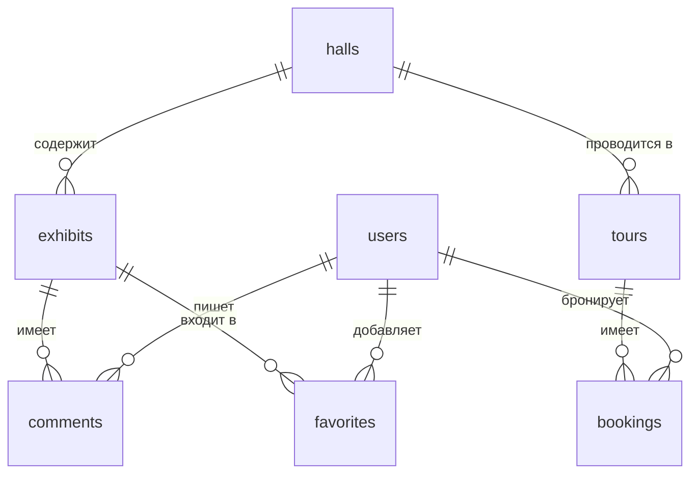

# Раздел 1. Анализ предметной области

## 1.1 Описание

Приложение «Музей» предназначено для автоматизации работы с посетителями музея с мобильных устройств под управлением ОС Android. Пользователь может посмотреть коллекцию экспонатов по залам, найти нужный экспонат, оставить отзыв с оценкой, добавить экспонат в избранное и записаться на экскурсию на удобные дату и время.

Цель — повысить удобство взаимодействия посетителя с музеем за счёт автономного мобильного интерфейса с локальным хранением данных (SQLite). Интернет для работы приложения не нужен.

## 1.2 Роли пользователей

| Роль | Что может делать |
|---|---|
| **Клиент (посетитель)** | Регистрация и вход; просмотр экспонатов по залам; поиск; просмотр карточки экспоната; отзывы и оценки; избранное; запись на экскурсию; просмотр и отмена своих записей; редактирование профиля (имя, пароль); смена темы |
| **Администратор** | Всё то же, что клиент, плюс панель администратора: добавление, редактирование и удаление экспонатов; добавление и удаление залов (справочник); просмотр всех броней и смена их статуса; удаление любых отзывов |

Администратор по умолчанию: логин `admin`, пароль `admin123`.

## 1.3 Основные сущности

- **Пользователь** — тот, кто пользуется приложением.
- **Зал** — раздел музея, к которому относятся экспонаты и экскурсии (справочник).
- **Экспонат** — предмет коллекции.
- **Отзыв** — комментарий посетителя с оценкой от 1 до 5.
- **Избранное** — связь «пользователь — экспонат».
- **Экскурсия** — услуга, на которую можно записаться.
- **Бронь** — запись пользователя на экскурсию с датой, временем, количеством человек и статусом.

## 1.4 Схема базы данных

База данных: `museum.db`, 7 таблиц. Внешние ключи включены (`setForeignKeyConstraintsEnabled(true)`), при удалении родительской записи дочерние удаляются каскадно (`ON DELETE CASCADE`).



### users — пользователи
| Поле | Тип | Описание |
|---|---|---|
| id | INTEGER PK AUTOINCREMENT | Идентификатор |
| login | TEXT NOT NULL UNIQUE | Логин |
| password | TEXT NOT NULL | Хеш пароля (SHA-256) |
| name | TEXT NOT NULL | Имя |
| role | TEXT NOT NULL | `user` или `admin` |

### halls — залы (справочник)
| Поле | Тип | Описание |
|---|---|---|
| id | INTEGER PK AUTOINCREMENT | Идентификатор |
| name | TEXT NOT NULL | Название зала |
| floor | INTEGER NOT NULL | Этаж |
| description | TEXT | Описание |

### exhibits — экспонаты
| Поле | Тип | Описание |
|---|---|---|
| id | INTEGER PK AUTOINCREMENT | Идентификатор |
| hall_id | INTEGER NOT NULL FK → halls.id | Зал |
| title | TEXT NOT NULL | Название |
| author | TEXT | Автор |
| year | TEXT | Год или век |
| description | TEXT | Описание |

### comments — отзывы
| Поле | Тип | Описание |
|---|---|---|
| id | INTEGER PK AUTOINCREMENT | Идентификатор |
| exhibit_id | INTEGER NOT NULL FK → exhibits.id | Экспонат |
| user_id | INTEGER NOT NULL FK → users.id | Автор отзыва |
| text | TEXT NOT NULL | Текст |
| rating | INTEGER NOT NULL | Оценка 1–5 |
| date | TEXT NOT NULL | Дата и время |

### favorites — избранное
| Поле | Тип | Описание |
|---|---|---|
| user_id | INTEGER NOT NULL FK → users.id | Пользователь |
| exhibit_id | INTEGER NOT NULL FK → exhibits.id | Экспонат |

Первичный ключ составной: (user_id, exhibit_id), чтобы нельзя было добавить один экспонат дважды.

### tours — экскурсии
| Поле | Тип | Описание |
|---|---|---|
| id | INTEGER PK AUTOINCREMENT | Идентификатор |
| hall_id | INTEGER NOT NULL FK → halls.id | Зал |
| title | TEXT NOT NULL | Название |
| description | TEXT | Описание |
| price | INTEGER NOT NULL | Цена взрослого билета, ₽ |
| duration | INTEGER NOT NULL | Длительность, мин |

### bookings — брони
| Поле | Тип | Описание |
|---|---|---|
| id | INTEGER PK AUTOINCREMENT | Идентификатор |
| user_id | INTEGER NOT NULL FK → users.id | Кто записался |
| tour_id | INTEGER NOT NULL FK → tours.id | Экскурсия |
| date | TEXT NOT NULL | Дата (дд.мм.гггг) |
| time | TEXT NOT NULL | Время (чч:мм) |
| adults | INTEGER NOT NULL | Кол-во взрослых |
| children | INTEGER NOT NULL | Кол-во детей |
| audio_guide | INTEGER NOT NULL | Аудиогид (0/1) |
| total | INTEGER NOT NULL | Итоговая сумма, ₽ |
| status | TEXT NOT NULL | `new`, `confirmed`, `cancelled`, `done` |

## 1.5 Расчёт стоимости экскурсии

```
итого = взрослые × цена + дети × (цена / 2) + (взрослые + дети) × 200 (если выбран аудиогид)
```

Сумма пересчитывается сразу при изменении количества людей или галочки аудиогида.

## 1.6 Архитектура приложения

- `data/DBHelper` — наследник `SQLiteOpenHelper`: создание таблиц, обновление версии, начальные данные.
- `data/MuseumRepository` — паттерн Repository: все SQL-запросы. Экраны не обращаются к базе напрямую.
- Все операции с БД выполняются в фоновом потоке через корутины (`withContext(Dispatchers.IO)`).
- `utils/SessionManager` — сессия пользователя и настройка темы в `SharedPreferences`.
- `ui/` — активити и фрагменты, `adapters/` — адаптеры `RecyclerView` с `ViewHolder`.
